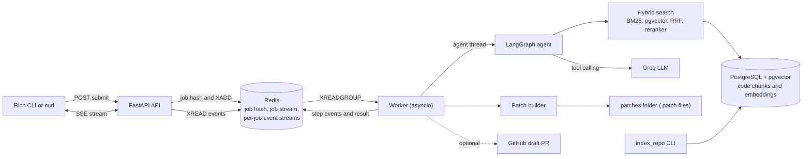
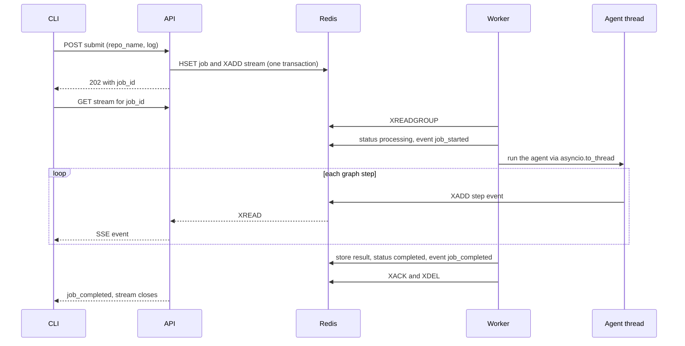
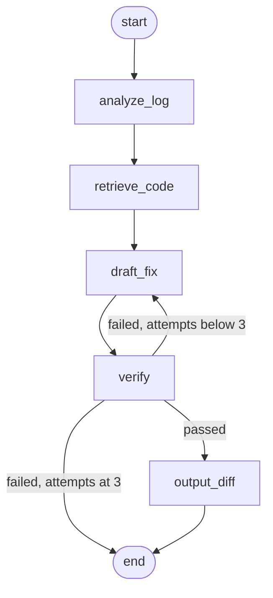

# AutoDev-Ops Agent

An autonomous incident triage and root-cause analysis engine. Submit a production log or stack
trace; the agent finds the relevant code in your repository, drafts a fix, verifies it, and emits a
`git apply`-able patch (and, optionally, a draft GitHub pull request) while streaming its reasoning
live to your terminal.

```
$ python -m app.cli.triage_cli submit --repo sample_repo --log-file scripts/sample_error.log
```

## How it works



### Life of a job



### The agent graph

The control flow is explicit, not free-form: the model never chooses which tool to call next.



| Node | What it does |
|---|---|
| `analyze_log` | The LLM reads the log and returns a root-cause hypothesis and a short code-search query (identifiers first). |
| `retrieve_code` | Hybrid search over the indexed repository returns the top 3 chunks. |
| `draft_fix` | The LLM names one retrieved function or method and returns its full replacement. On a retry it also sees why the previous draft was rejected. |
| `verify` | Deterministic checks (below) on the replacement code. |
| `output_diff` | Builds a diff preview for the live display. |

After the graph, the worker builds the real patch from the file on disk and, if configured, opens a draft PR.

## Design decisions

### AST chunking instead of fixed-size text windows

Repositories are parsed with Python's `ast` module and split exactly at function, method and class boundaries.

| Advantage | Why it matters here |
|---|---|
| Chunks are semantic units | Retrieval returns whole functions, so the model sees complete context, never half a function. |
| Exact metadata | Each chunk carries file path, qualified name (`ConnectionPool.acquire`), type, and a 1-based line range. This is what makes precise patches possible. |
| Safe edits | Because a chunk is a whole function, the model can return a replacement for exactly that line range, and we compute the diff ourselves (models are unreliable at writing diff line numbers). |
| Drift detection | Before patching, the file's lines are compared to the indexed chunk. A stale index is refused instead of producing a patch that will not apply. |
| No duplication | A class chunk contains the class text *minus* method bodies (header, docstring, attributes). Methods are their own chunks. Decorators are included in a function's span. |
| Deterministic | No heuristics or token counts; the same repo always yields the same chunks in the same order. |
| Fault tolerant | A file with a syntax or encoding error is skipped and reported; it never aborts indexing. |

Scope limits: Python only; module-level statements (constants, top-level scripts) and functions defined
under `if`/`try` blocks at module level are not chunked; nested functions stay inside their parent chunk.

### Hybrid retrieval

1. **BM25** (`rank-bm25`) with an identifier-aware tokenizer: `ERR_DB_TIMEOUT` is indexed whole *and* as `err`, `db`, `timeout`; `DatabaseTimeout` as `databasetimeout`, `database`, `timeout`. No stemming, because exact identifiers matter in code.
2. **Dense** search in PostgreSQL with pgvector, using `BAAI/bge-base-en-v1.5` (768 dimensions, cosine, HNSW index). Queries get the model's recommended retrieval prefix; documents do not.
3. **Reciprocal Rank Fusion** (k = 60) merges the two rankings without needing comparable scores.
4. A **cross-encoder** (`cross-encoder/ms-marco-MiniLM-L-6-v2`) reranks the fused top 10 and the top 3 go to the model.

Dense search is weak on exact identifiers and BM25 is weak on paraphrase; fusing them covers both. The reranker was trained on web text, not code, so treat its ordering as a strong hint rather than a guarantee.

### Reliable agent output

- **Structured output via forced tool calling** (`submit_analysis`, `submit_fix`) at temperature 0; arguments are parsed as JSON, never scraped from prose.
- The `chunk_id` field of `submit_fix` is a JSON-schema **enum of the retrieved function and method chunk ids**, so the model cannot name code it was not shown.
- **Bounded retries:** up to 3 draft/verify rounds, with the verifier's message fed back to the model.
- **Verification** is deterministic: `ast.parse` and `compile()` (catches syntax errors and compile-time errors such as `await` outside `async`), exactly one top-level function whose name is unchanged, and rejection of no-op fixes. **Tests are not run**, and no linter is used. A "verified" fix is a syntactically valid, structurally sane replacement, not a proven-correct one.

### Queue: Redis Streams, no Celery

A custom asyncio worker on Redis Streams consumer groups keeps dependencies minimal, fits the async
stack (and Windows), and reuses Redis for live events.

- **At-least-once delivery.** A job is acknowledged only after its result is stored. A crashed worker's job is reclaimed (`XAUTOCLAIM`) after 5 minutes idle. **Handlers must be idempotent.**
- **Retries:** up to 3 deliveries, then the job is marked `failed`. `PermanentJobError` (for example an unindexed repo) fails immediately with no retries.
- **Per-job timeout** (240 s, always shorter than the claim window). The agent runs in `asyncio.to_thread`, so the event loop stays responsive; a timed-out thread cannot be killed and finishes in the background.
- **Housekeeping:** acknowledged entries are deleted from the stream (it only holds unprocessed jobs); finished job hashes expire after 7 days; per-job event streams expire 24 hours after their last event.
- Scale by running more worker containers; each loads its own models.

### Live streaming (SSE)

`GET /api/v1/triage/stream/{job_id}` reads the job's Redis event stream and forwards it with
`sse-starlette`.

- **Replay:** connecting late replays the job's full history.
- **Resume:** the SSE `id` is the Redis stream ID; the standard `Last-Event-ID` header continues after that event. The CLI reconnects automatically (up to 3 times).
- The stream closes after a terminal event; an idle job ends with a `timeout` event after 15 minutes.
- Errors: `404` unknown or malformed job id, `400` bad `Last-Event-ID`.

### Patches

The real patch is computed against the actual file on disk, not the indexed copy. It handles LF and
CRLF files, a last line with no trailing newline (git's `\ No newline at end of file` marker), and is
written as bytes so Windows cannot rewrite line endings. It refuses UTF-8 BOM files, non-UTF-8 files,
paths escaping the repo, missing files, stale indexes and no-op fixes. A patch problem never fails
the job: the verified fix is still stored, with `patch_error` set.

### Optional draft GitHub PR

Off unless `GITHUB_TOKEN` is set **and** the repo is mapped in `AUTODEV_GITHUB_REPOS`. It uses the
GitHub REST API over stdlib `urllib` (no extra dependency): branch `autodev/<job_id>`, one commit
through the Contents API, then a **draft** PR whose body contains the hypothesis, the patch and an
explicit note that tests were not run.

- It first compares the remote base-branch file with the local original (ignoring line-ending differences) and refuses, with no side effects, if they differ.
- It follows the remote file's line-ending style.
- It is idempotent for a given job: an existing PR is returned, and an existing branch is resumed.
- A GitHub failure never fails the job; `pr_error` is stored instead.

## Setup (Docker)

Requirements: Docker with Compose v2, a Groq API key and a Groq model that supports tool calling
(see the Groq docs). Python 3.11 is only needed on the host to run the CLI.

```bash
# 1. configure
cp .env.example .env            # edit: POSTGRES_PASSWORD, GROQ_API_KEY, GROQ_MODEL
mkdir -p repos patches
cp -r sample_repo repos/sample_repo      # repos you want triaged live under ./repos/<name>

# 2. build and start (first build downloads CPU-only PyTorch)
docker compose up -d --build
docker compose ps               # postgres, redis, api: healthy; worker: running

# 3. index a repository (the first run downloads the embedding model into a volume)
docker compose run --rm worker python -m app.cli.index_repo --path /repos/sample_repo --name sample_repo

# 4. install the CLI's dependencies on the host and run it
python3.11 -m venv .venv && source .venv/bin/activate
pip install -r requirements.txt
python -m app.cli.triage_cli submit --repo sample_repo --log-file scripts/sample_error.log
```

Windows PowerShell equivalents: `Copy-Item .env.example .env`, `mkdir repos, patches`,
`Copy-Item -Recurse sample_repo repos\sample_repo`, `.venv\Scripts\Activate.ps1`.

A verified fix prints the patch path (`/data/patches/<job_id>.patch` inside the container, which is
`./patches/<job_id>.patch` on your host). Apply it:

```bash
git apply --check path/to/patch.patch    # silent means it applies
git apply path/to/patch.patch
```

Run it from the root of the repository the patch was made for. Patch paths are relative to that
repository's root; for the bundled sample from this project's root, use
`git apply --directory=sample_repo patches/<job_id>.patch`.

### Indexing your own repository

Put (or copy) the checkout at `./repos/<name>` and run the `index_repo` command with
`--path /repos/<name> --name <name>`. Submit jobs with `--repo <name>`. Re-run it after the code
changes, because patches are refused if the file no longer matches the index.

### Optional: draft GitHub PRs

Set in `.env`:

```
GITHUB_TOKEN=<fine-grained token limited to the target repo: Contents + Pull requests, read and write>
AUTODEV_GITHUB_REPOS=sample_repo=youruser/yourrepo
AUTODEV_GITHUB_BASE_BRANCH=main
```

The GitHub repository must contain the files at the same relative paths as your local checkout (for
the sample: `shop/db.py` at the repo root). Then `docker compose up -d worker` to apply the change.

## Local development (without containerising the app)

Run only the infrastructure in Docker and the Python processes on the host:

```bash
docker compose up -d postgres redis
export POSTGRES_PASSWORD=<value from .env>      # host scripts default to localhost:5433
export GROQ_API_KEY=... GROQ_MODEL=...
uvicorn app.api.main:app --port 8000            # terminal 1
python -m app.queue.run_worker                  # terminal 2
python -m app.cli.index_repo --path sample_repo --name sample_repo
python -m app.cli.triage_cli submit --repo sample_repo --log-file scripts/sample_error.log
```

## Using the API directly

```bash
curl -s -X POST http://127.0.0.1:8000/api/v1/triage/submit \
  -H "Content-Type: application/json" \
  --data-binary "@scripts/sample_payload.json"
# {"job_id":"<32 hex chars>","status":"queued"}

curl -N http://127.0.0.1:8000/api/v1/triage/stream/<job_id>
```

On Windows PowerShell use `curl.exe`.

| Event (SSE `event:`) | Meaning | Data |
|---|---|---|
| `job_started` | an attempt began | `attempt` |
| `step` | a graph node finished | per node: hypothesis and query / retrieved chunks / draft code / verdict / diff |
| `job_retrying` | the attempt failed, will retry | `attempt`, `error` |
| `job_completed` | terminal | `result` (see below) |
| `job_failed` | terminal | `error` |
| `timeout`, `stream_error` | terminal, stream problem | details |

`result` fields: `evaluation_status` (`passed` or `failed`), `attempts`, `hypothesis`, `search_query`,
`verification_feedback`, `proposed_fix` (only when passed), `diff_preview`, `retrieved`, `patch`,
`patch_path`, `patch_error`, `pr_url`, `pr_number`, `pr_error`.

A job's `status` is `completed` whenever the agent finished; the verdict is
`result.evaluation_status`. A job is `failed` only when it errored permanently.

### CLI

```
python -m app.cli.triage_cli [--api URL] submit --repo NAME --log-file FILE
python -m app.cli.triage_cli [--api URL] watch JOB_ID      # live or replay
```

Exit codes: `0` verified fix, `1` completed without a verified fix, `2` usage error, `3` job failed,
`4` stream or connection problem.

## Configuration

| Variable | Default | Purpose |
|---|---|---|
| `POSTGRES_PASSWORD` | none, required | Postgres password (Compose refuses to start without it) |
| `POSTGRES_USER` / `POSTGRES_DB` | `autodev` | Postgres user and database |
| `POSTGRES_HOST` / `POSTGRES_PORT` | `localhost` / `5433` | Where host-side code finds Postgres (set to `postgres` / `5432` in the worker container) |
| `POSTGRES_HOST_PORT` | `5433` | Host port the Postgres container is published on (127.0.0.1 only) |
| `REDIS_HOST` / `REDIS_PORT` | `localhost` / `6379` | Redis location |
| `GROQ_API_KEY`, `GROQ_MODEL` | none, required by the worker | LLM access; the model must support tool calling |
| `GITHUB_TOKEN`, `AUTODEV_GITHUB_REPOS`, `AUTODEV_GITHUB_BASE_BRANCH` | empty, empty, `main` | Optional draft PRs |
| `AUTODEV_REPOS_DIR` | project root (`/repos` in the container) | Repo checkouts live at `<dir>/<repo_name>` |
| `AUTODEV_PATCH_DIR` | `./patches` (`/data/patches` in the container) | Where `.patch` files are written |
| `AUTODEV_JOB_TTL_S` | `604800` (7 days) | Expiry of finished job hashes |
| `REPOS_HOST_DIR`, `PATCHES_HOST_DIR` | `./repos`, `./patches` | Compose bind-mount sources |

## Project structure

```
app/
  ingestion/   AST chunker and chunk models
  db/          connection, schema, chunk store
  search/      tokenizer, BM25, embedder, dense search, reranker, hybrid retriever (RRF)
  agent/       state, tools, graph, prompts, Groq adapter, runner
  queue/       jobs, events, worker, errors, triage handler, worker entry point
  patch/       patch builder and service
  github/      REST client, draft-PR logic, service
  api/         FastAPI app, schemas, SSE endpoint
  cli/         SSE client, renderer, triage CLI, index_repo
scripts/       verification scripts and sample data
Dockerfile, docker-compose.yml, .env.example
```

## Testing

Every module ships with a deterministic verification script. Scripts that load the embedding models
need Postgres and Redis running; none of them needs a real API key except `verify_llm_live.py` and
the job step of `verify_stack.py`. Host-side scripts need `POSTGRES_PASSWORD` set to match `.env`.

| Script | Covers |
|---|---|
| `verify_infra.py` | dependency imports, Postgres and pgvector, Redis |
| `verify_ingestion.py` | AST chunking, metadata, line ranges, syntax-error handling |
| `verify_bm25.py`, `verify_dense.py`, `verify_hybrid.py` | schema, BM25, embeddings and pgvector search, RRF and reranking |
| `verify_submit.py` | submit endpoint and Redis enqueue (needs the API running) |
| `verify_worker.py` | consumer group, ack, retry, timeout, crash recovery |
| `verify_agent.py` | agent tools and graph transitions, including the retry loop |
| `verify_llm_adapter.py` | the LLM adapter, against a fake client |
| `verify_llm_live.py` | a real Groq model through the full graph (needs the Groq variables) |
| `verify_triage_worker.py` | the graph wired into the worker, off the event loop |
| `verify_events.py` | per-job event streams |
| `verify_sse.py` | SSE endpoint, replay, resume, the CLI client, the renderer |
| `verify_patch.py` | patches validated with real `git apply` (LF, CRLF, no trailing newline) |
| `verify_github_pr.py` | draft-PR flow against a fake GitHub API |
| `verify_cleanup.py`, `verify_index_cli.py` | stream cleanup, expiry, `index_repo` |
| `verify_stack.py` | the live Compose stack, including one real job |

## Security posture and known limitations

Be honest with yourself about these before exposing the service:

- **No API authentication, rate limiting or TLS.** Ports are bound to `127.0.0.1`. Do not publish them to a network without a reverse proxy (Caddy, nginx or a cloud load balancer) that adds TLS, authentication and rate limits.
- **Your logs and code leave the machine.** Logs and retrieved code chunks are sent to the configured LLM provider, and the PR body contains the model's summary. Do not submit logs that contain secrets or data you may not share.
- **"Verified" is a syntax check.** Fixes are not executed or tested. Review every patch and PR before merging; PRs are drafts for that reason.
- **Scope of a fix:** one function or method per job, Python only.
- **Index freshness:** re-run `index_repo` after the code changes; otherwise patches are refused.
- **Single replica semantics:** delivery is at-least-once; a timed-out agent thread cannot be killed.
- **Image size:** one image serves the API and the worker, so the API carries PyTorch it does not use.
- **Secrets** are read from environment variables (`.env` is gitignored and excluded from the image). Use your platform's secret manager in production.

## Ideas for the future

API-key authentication; running the target repository's tests in a sandbox before opening a PR;
module-level and multi-language chunking (for example with `tree-sitter`); separate lean API and
worker images; multi-file fixes.